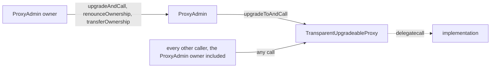

# Upgrade & storage-layout invariants

Each of these contracts is deployed behind its own OpenZeppelin 5.1.0
`TransparentUpgradeableProxy`:

- `ENSRegistry`
- `BaseRegistrarImplementation`
- `SimplexResolver`
- `SubnameRegistrar`
- `SimplexController`
- `SimplexNamePolicy`
- `SimplexSponsor`
- `UniversalResolver`

The `.testing` controller, behind a UUPS proxy, is upgraded under `docs/upgrades.md`
at tag `simplex-mainnet-testing-v3`, the source of its fixes.

A `ProxyAdmin` of its own is created by each proxy's constructor; the address
of the `ProxyAdmin` is an immutable of the proxy. The owner of the `ProxyAdmin`
upgrades the proxy with
`ProxyAdmin.upgradeAndCall(proxy, implementation, data)`. In an upgrade, the
implementation behind a proxy is replaced and the proxy's storage is kept — so
the exact storage layout of the old implementation **must be kept** by the new
one, only appended to. Get this wrong and existing values (prices, the sponsor, …) are
silently read from the wrong slots.

Upgradeability is not permanent. A contract is frozen when the owner of its
`ProxyAdmin` calls `renounceOwnership()`: from then on `upgradeAndCall`
reverts, and the proxy's admin, an immutable, cannot be replaced. Each contract
is frozen at a time of its own; everything in this document applies to a
contract until its `ProxyAdmin` is renounced. `renounceOwnership()` and
`transferOwnership` are sent to the `ProxyAdmin`, the CREATE address of the
proxy at nonce 1 that `scripts/prepare-upgrade.mjs` prints, never to the proxy:
the same selectors are declared by `BaseRegistrarImplementation` and
`SimplexController`, and a call of the `ProxyAdmin` owner to the proxy is
delegated to them and applied to the contract's own ownership. A freeze is
refused by `scripts/prepare-upgrade.mjs` while the admin Safe owns the
`ProxyAdmin`; its preparation once GOV8 has moved the `ProxyAdmin` to the
timelock (launch-to-freeze plan, A7) is a prerequisite of GOV8.



## Transparent proxies

- The addresses of the implementation and of the admin are stored at the
  ERC-1967 slots, `keccak256("eip1967.proxy.implementation") - 1` and
  `keccak256("eip1967.proxy.admin") - 1`, outside the sequential layout.
- For a call from the `ProxyAdmin`, only `upgradeToAndCall` is executed; any
  other call from it is reverted with `ProxyDeniedAdminAccess`. A call from any
  other address is delegated to the implementation.
- An implementation must not declare `upgradeTo(address)`,
  `upgradeToAndCall(address,bytes)` or `proxiableUUID()`, so that the
  `ProxyAdmin` stays the only upgrade path.
- An implementation must not write the ERC-1967 slots.
- The storage layouts of the eight implementations are recorded in
  `test/simplex/__snapshots__/storageLayouts.json`: one line per variable,
  `slot:offset+bytes Contract.label type` with its declaring contract, and
  below it one indented line per struct member, `slot:offset+bytes label
  type`. In `test/simplex/TestUpgradeableStack.test.ts`, the compiled layouts
  are compared with it and the eight ABIs are checked for the selectors above.
  With an upgrade that changes a layout, the snapshot is regenerated by
  `pnpm exec vitest run -u test/simplex/TestUpgradeableStack.test.ts -t
  'storage layouts'`, run in CI on a `ci/**` branch of the fork whose workflow
  uploads the file, and committed with the upgrade. Its diff is limited by
  invariants 1 and 2 to these changes: the lines of new variables are inserted
  before the trailing `__gap`, or appended in a contract without one; values are appended to the list of an enum; the
  start slot of the `__gap` line is raised, and its length reduced, by the
  whole slots occupied by the new variables; every other line is unchanged.

## Storage model

Slots are laid out base-contracts-first. Where each contract's own variables
start:

| Contract | Slots of the base contracts | First own slot | `__gap` |
|---|---|---|---|
| `ENSRegistry` | 0: `Initializable` | 1 | – |
| `BaseRegistrarImplementation` | 0-9: `ERC721`, `ERC721Enumerable`; 10: `Ownable`, `Initializable` | 11 | – |
| `SimplexResolver` | 0: `ResolverBase`; 1-11: the resolver profiles; 12-13: `PublicResolver` | 14 | – |
| `SubnameRegistrar` | – | 0 | – |
| `SimplexController` | 0-150: `Initializable`, `ContextUpgradeable`, `OwnableUpgradeable`, `Ownable2StepUpgradeable` | 151 | `uint256[43]` |
| `SimplexNamePolicy` | – | 0 | `uint256[42]` |
| `SimplexSponsor` | – | 0 | – |
| `UniversalResolver` | – | – (immutables only) | – |

```
contract SimplexController is
    Initializable, Ownable2StepUpgradeable, IETHRegistrarController, ERC165
```

Slots 0 to 150 are taken by the OZ upgradeable parents and are left alone: slot
0 by `Initializable`, whose `_initialized` and `_initializing` are its only
variables, and slots 1 to 150 by `ContextUpgradeable`, `OwnableUpgradeable` and
`Ownable2StepUpgradeable`, each with its own `__gap`. This contract's own
variables start at slot 151. After them come
`ens`, `base`, `minCommitmentAge`, `maxCommitmentAge`, two reserved slots
(below), `prices`, `tldNode`, `tldSuffix`, `commitments`, `minCharLength`,
`_unusedReservedNames`, `smpxNft` + `nftGateEnabled` + `_unusedPriceOracleFrozen`
(packed), `_reentrancyStatus`, then the names-v2 block:

```solidity
address public beneficiary;
address public sponsor;
address public defaultResolver;                    // packs with `publicSalesOpen`
bool    public publicSalesOpen;
mapping(address => bool) public wasDefaultResolver;
address public namePolicy;

uint256[43] private __gap;   // shrinks as state is added
```

`__gap` was `[50]`; `[49]` when `priceOracleFrozen` landed, `[48]` with
`_reentrancyStatus`, `[44]` with the four names-v2 slots, and `[43]` with
`namePolicy`. It is the budget for future state.

**Reserved slots.** Three kinds of placeholder exist, and all are deliberate:

- `_unusedPriceOracleFrozen` — was `priceOracleFrozen`, kept when
  `freezePriceOracle` was removed. Pricing must stay changeable, because the
  Chainlink feed is `immutable` inside the oracle and a retired feed would
  otherwise end registration and renewal forever.
- `_unusedReverseRegistrar`, `_unusedDefaultReverseRegistrar` — were the two
  reverse-registrar references, kept when reverse resolution was removed.
- `_unusedReservedNames` — was `reservedNames`, kept when the reserved-names
  list moved to `SimplexNamePolicy`.

They are declarations kept so that removing a feature does not shift any slot
below it (invariant 2).

### `Reason` is storage

`Reason` is stored in `SimplexNamePolicy._names`, and an enum is stored as its
member's position. Once `.simplex` has reservations, every name reserved under
a member is relabelled, silently, when that member is reordered or removed.
Values are only appended to the enum (invariant 2), and `None` is kept at
0 — `delete` writes zero. The members of `NameEntry` share one slot in
declaration order, so reordering them swaps the two lists; keep them unchanged
(invariant 2).

## Invariants (do not break these)

1. **Append only, from the front of `__gap`.** A new state variable is declared
   immediately *before* `__gap`. The end slot of the trailing `__gap` is
   unchanged, and `__gap` is shortened by the whole slots occupied by the new
   variables; a variable packed into the unused bytes of the preceding slot
   counts as zero whole slots, so `__gap` is unchanged by a `bool` after
   `SimplexController.namePolicy` (slot 169, offset 20). In a contract without
   `__gap`, a new variable is declared after the last one. Variables are added
   to the most derived contract only: a merge from upstream ENS that adds a
   variable to `PublicResolver` or a profile, or an OpenZeppelin upgrade that
   adds one to `ERC721`, `ERC721Enumerable` or `Ownable`, moves every variable
   after it and is refused (invariant 2).
2. **The label, slot, offset and type of an existing variable are unchanged.**
   Never reorder, remove, rename or retype one. The members of a stored struct
   are unchanged, and values are only appended to an enum.
3. **Never reorder the base contracts** in the `is (...)` list, and add no base
   contract with storage — by either, existing variables are moved.
   `Initializable` is kept at
   `@openzeppelin/contracts-upgradeable` 4.9.3 in `ENSRegistry`,
   `BaseRegistrarImplementation` and `SimplexController`: its `_initialized`
   (in the registrar, slot 10, offset 20) is the state by which a second
   `initialize` is reverted, and the state of the 5.x `Initializable` is read from an
   ERC-7201 slot, which is zero in an existing proxy.
4. `constant` / `immutable` values are compiled into the implementation, not
   stored in the proxy, so they are replaced in an upgrade. The value of each
   immutable is kept in a new implementation unless changing it is the
   purpose of the upgrade. The immutables of `SimplexResolver` (`ens`;
   `nameWrapper`, the subname registrar; `trustedETHController`, the
   controller; `trustedReverseRegistrar`) and of `SubnameRegistrar` (`ens`,
   `baseRegistrar`) are those by which the writers of records are determined;
   `SubnameRegistrar`'s `_deployer` is the only caller of its one-time
   `setResolver`. `SimplexSponsor` is bound to one controller by its
   `controller`. The registry read by `UniversalResolver`, its batch gateways,
   and the gas of its calls to contracts without detected EIP-140 support are
   fixed by its `registry`, `batchGatewayProvider` and `unsafeCallGas`. By
   `scripts/prepare-upgrade.mjs` in brenzi/simplex-namespace-contract, the
   runtime code of a candidate is compared with its artifact, with the current
   immutables in place, except `SimplexNamePolicy._self`,
   `SubnameRegistrar._deployer` and `_proxyAdmin`, which are expected to hold
   the candidate's own address, its deployer and the proxy's `ProxyAdmin`.
5. **Every external function, event and custom error of the current
   implementation is kept** by a candidate, with the same selector, return
   types, mutability and event indexing, and the same meaning, unless
   removing one is the purpose of the upgrade and the `INTENDED` input of
   `scripts/prepare-upgrade.mjs` names it; a candidate without a selector or
   an event topic of the current implementation that `INTENDED` does not name
   is refused by the script. Custom errors are part of the interface because
   off-chain callers decode them: on a `TermsNotAccepted` revert, the names
   service reads the name policy again. The functions below are called by
   other contracts of the stack, so once a caller is frozen or immutable,
   these functions are a fixed interface. The EIP-712 domain name and version,
   each `*_TYPEHASH`, and each function called from outside the stack are
   part of the interface. Their signers and callers are the names service, the
   webstore, each SimpleX app version in use, the dApp, the resolver service
   (`snrc-resolve.py`), ERC-721 wallets and
   marketplaces, and `UniversalResolver` integrators. A changed intent or replaced
   function is added beside the current one where accepting the current one
   stays safe, and the current one is dropped through `INTENDED` after every
   signer and caller uses the successor. Where accepting the current one after
   the upgrade is unsafe, the signers and callers stop using it from the
   batch's proposal and use the successor from its execution; the sponsored
   paths are then interrupted until execution, for at least the timelock's
   delay once a `TimelockController` owns the `ProxyAdmin`. The upgrade's plan
   names the way and the owner approves it.

### Calls between the contracts of the stack

| Called contract | Caller | Functions |
|---|---|---|
| `ENSRegistry` | `BaseRegistrarImplementation` | `owner`, `setResolver`, `setSubnodeOwner` |
| `ENSRegistry` | `SimplexController` | `resolver`, `setRecord` |
| `ENSRegistry` | `SimplexNamePolicy` | `resolver`, `setRecord` |
| `ENSRegistry` | `SubnameRegistrar` | `owner`, `setSubnodeRecord`, `setResolver`, `setOwner` |
| `ENSRegistry` | `SimplexResolver` | `owner` |
| `ENSRegistry` | `Root` | `setSubnodeOwner`, `setResolver` |
| `ENSRegistry` | `UniversalResolver` | `resolver` |
| `BaseRegistrarImplementation` | `SimplexController` | `available`, `nameExpires`, `registerWithLabel`, `renew`, `transferFrom` |
| `BaseRegistrarImplementation` | `SimplexNamePolicy` | `available`, `registerWithLabel`, `transferFrom` |
| `SimplexController` | `SimplexNamePolicy` | `owner`, `beneficiary`, `defaultResolver`, `wasDefaultResolver`, `commitments`, `maxCommitmentAge`, `commit`; `ens` and `tldNode` in its constructor |
| `SimplexController` | `SimplexSponsor` | `beneficiary`, `rentPriceUSD`, `registerSponsored`, `renewSponsored` |
| `SubnameRegistrar` | `BaseRegistrarImplementation`, as its subname hook | `onReregister`, `onExpiryChanged` |
| `SubnameRegistrar` | `SimplexResolver`, through its wrapper slot | `ownerOf(uint256)` |
| `SimplexResolver` | `SubnameRegistrar` | `clearSubnameRecords` |
| `SimplexResolver` | `SimplexController` | `clearRecords`, `multicallWithNodeCheck` |
| `SimplexResolver` | `SimplexNamePolicy` | `clearRecords` |
| `SimplexResolver` | `UniversalResolver` | `supportsInterface` and the resolver functions requested through it |
| `SimplexNamePolicy` | `SimplexController` | `controller`, `isReserved`, `communityNames`, `consumeRegistration` |
| `SimplexNamePolicy` | `BaseRegistrarImplementation` | `registrar`, `consumeTransfer` |

`SimplexSponsor` and `UniversalResolver` are called only from outside the
stack. `registerSponsored` and `renewSponsored` of `SimplexController` revert
for any caller other than the address in its `sponsor`, the sponsor's proxy,
which is unchanged by an upgrade of the sponsor.

The eight also call contracts outside them:

| Called contract | Caller | Functions | Replaced by |
|---|---|---|---|
| `MetadataRenderer` | `BaseRegistrarImplementation` | `tokenURI` | `setMetadataRenderer` |
| the price oracle | `SimplexController` | `price`, `priceUSD` | `setPriceOracle` |
| the NFT of the gate, with the gate on | `SimplexController` | `balanceOf` | – |
| the gateway provider | `UniversalResolver` | `gateways` | an upgrade whose `INTENDED` names `batchGatewayProvider` |

With an upgraded caller, their interface is kept, or the instance named in the
last column is set.

### Adding a variable — example

```solidity
   address public namePolicy;          // last existing variable, slot 169
+  address public somethingNew;        // slot 170, one whole slot
-  uint256[43] private __gap;
+  uint256[42] private __gap;          // slots 171-212, ends where it did
```

### Retiring a variable — keep its declaration

A variable out of use is kept with its label, type and place, so no slot below
it is moved and `__gap` is untouched.

## Pre-upgrade checklist

- [ ] **Validate the storage layout against the deployed implementation.** By
      `scripts/prepare-upgrade.mjs` in brenzi/simplex-namespace-contract, the
      layouts are compared with the deployed layout recorded in
      `verification.mainnet.simplex.json`, the UUPS selectors, a `fallback` and
      a `receive` are refused, and the calldata of `ProxyAdmin.upgradeAndCall`
      is printed. Update `test/simplex/__snapshots__/storageLayouts.json` in the
      same commit and review its diff.
- [ ] **Run an upgrade test of the contract being upgraded.** Copy the source
      file of its deployed version, from the tag of that deployment, to
      `contracts/test/upgrades/` under another contract name, with its relative
      imports pointed at `contracts/`; a duplicated interface is referenced by
      its fully qualified name. Deploy the copy
      behind a `TransparentUpgradeableProxy`, write every stored variable,
      upgrade through the `ProxyAdmin` with the intended `data`, and assert
      every value and the guard of the `data` function. The copy is compiled
      with the base contracts of the current tree, so the `data` function and
      the values it writes are checked by the test, and the layout against the
      deployed implementation by `scripts/prepare-upgrade.mjs`.
- [ ] **Run `test/simplex/TestControllerStorageLayout.test.ts`.** In it, raw
      slots of a deployed proxy are read, and the packing and the reserved
      slots are asserted directly.
- [ ] **Review the new code for `delegatecall`.** By a `delegatecall` to an
      address other than the contract itself, that code is executed against
      the proxy's storage, the ERC-1967 slots included.
- [ ] **Review the new code for state written at construction.** By a
      constructor or the initializer of a state variable, the implementation's
      storage is written, never the proxy's. State that the proxy needs is written by a
      function passed as the `data` of `ProxyAdmin.upgradeAndCall`, never by
      the constructor. The registry's root owner and the registrar's `ens`,
      `baseNode` and owner, written by their constructors, reach a proxy only
      because `initialize` writes them again at deployment. The constructors of
      `ENSRegistry`, `BaseRegistrarImplementation` and `SimplexController`
      keep `_disableInitializers()`, and a candidate whose `_initialized` is not
      255 is refused by `scripts/prepare-upgrade.mjs`. `constant` and `immutable`
      values are exempt (invariant 4). The function passed as `data` runs with
      the `ProxyAdmin` as `msg.sender`: an
      `onlyOwner` function reverts there, and the `ProxyAdmin` is recorded as
      the caller wherever one is recorded. With `SimplexResolver.multicall` or
      `SimplexResolver.multicallWithNodeCheck` as `data`, each entry is
      executed by a `delegatecall` to `address(this)`, that is by the proxy's
      own code with the `ProxyAdmin` as `msg.sender`: an entry with the
      selector of `upgradeToAndCall` is executed as a nested upgrade, by which
      its own implementation is installed in place of the candidate
      (demonstrated for both in `TestUpgradeableStack.test.ts`), and any other entry
      reverts `ProxyDeniedAdminAccess`, discarded by `require(success)`, so
      that `upgradeAndCall` reverts `FailedCall()`. Any function that makes a
      `delegatecall` to `address(this)` is prohibited as `data`.
- [ ] **Review the new immutables.** A new immutable is assigned from
      constructor arguments only: at construction, `address(this)` is the
      implementation and `msg.sender` its deployer, so a domain separator or an
      owner derived from either is wrong under the proxy.
      `SimplexNamePolicy._self` and `SubnameRegistrar._deployer` are assigned
      the implementation's address and its deployer by design.
- [ ] **Guard the function passed as `data`.** In each of the eight contracts it
      reverts unless `msg.sender` equals the immutable `_proxyAdmin`, the
      proxy's `ProxyAdmin` (its CREATE address at nonce 1), passed to the new
      implementation as the constructor input `proxyAdmin`; with an input
      named `_proxyAdmin`, the immutable is shadowed and left zero. In
      `ENSRegistry`, `BaseRegistrarImplementation` and `SimplexController` it is
      also a `reinitializer(n)`. No `delegatecall` to `address(this)` is made
      by the function. By `scripts/prepare-upgrade.mjs`, the proxy's
      `ProxyAdmin` is passed automatically to a constructor input named
      `proxyAdmin`, the immutable `_proxyAdmin` is checked against that
      `ProxyAdmin`, a non-empty `data` for a candidate without a `_proxyAdmin`
      immutable and code that contains an ERC-1967 slot are refused, the `data`
      is encoded, and the upgrade is simulated. Outside `reinitializer(n)`, the
      guard is passed again in any later `upgradeAndCall` of the same proxy, so
      a function passed as `data` without `reinitializer(n)` is written so that
      a second run changes nothing; it is dropped from a later candidate only
      through `INTENDED` (invariant 5).
- [ ] **Order upgrades whose interfaces change together.** An upgrade whose
      new code calls a function added to another contract of the stack in
      that contract's own upgrade is sent after that upgrade, or with it in one
      Safe MultiSend batch; one `upgradeAndCall` at a time is simulated by
      `scripts/prepare-upgrade.mjs`. An upgrade in which a function called by
      the current code of another contract of the stack is dropped through
      `INTENDED` is sent after that contract's upgrade, or with it in one Safe
      MultiSend batch. A changed signature is a dropped and an added function
      at once, so the upgrades of the contract and of its callers are sent in
      one batch, simulated on a mainnet fork before it is proposed. Such a
      batch is prepared by the batch extension of `scripts/prepare-upgrade.mjs`
      delivered before the first batch upgrade, #49's: each candidate is
      prepared, the Safe MultiSend is
      assembled and simulated on a mainnet fork with the admin Safe
      impersonated, and each implementation slot is compared with its
      candidate. The same simulation and comparison are applied to every single
      upgrade. A function that the names service or the dApp calls is dropped
      only after they call its successor, except by the replacement way of
      invariant 5, named in the upgrade's plan.
- [ ] **Keep the EIP-712 pin tests.** The six domains are pinned by
      `TestEip712Domains.test.ts`, and the twelve `*_TYPEHASH` values by
      `TestApproveAllWithSig`, `TestApproveClaimWithSig`,
      `TestClearRecordsWithSig`, `TestCommunityTerms`,
      `TestCreateSubnameWithSig`, `TestRecipientConsent` and
      `TestSimplexResolver`; these tests are changed only when the upgrade's
      plan names the intent change.
- [ ] Confirm that `owner()` of the proxy's `ProxyAdmin` is the intended admin
      before the upgrade tx. Every upgrade through a renounced `ProxyAdmin`,
      whose owner is `0x0`, reverts.
- [ ] Bump the `__gap` size in the same commit as any new state variable, so the
      two never drift.

## `SimplexNamePolicy`

The name policy (reserved names, community names, terms links, acceptances) is
deployed behind its own `TransparentUpgradeableProxy`. It is bound to one controller and
one registrar by its immutables `controller()` and `registrar()`; a candidate
whose `controller()` or `registrar()` differs from the current one is refused
by `scripts/prepare-upgrade.mjs`, unless its `INTENDED` input names that
immutable for an intended change. Its own variables are
`_names` (each name's community flag and reservation reason, in one slot),
`communityTermsHash`, `acceptedTerms`, `acceptedClaimTerms`, `nonces`,
`communityTermsLink`, `generalTermsLink`, `generalTermsHash`, then
`uint256[42] __gap`; the invariants above apply to it unchanged.

The controller's `MIN_REGISTRATION`, `MAX_REGISTRATION` and
`MAX_SPONSORED_REGISTRATION` are compiled into the policy, and the controller's
`ens` and `tldNode` are read once, in its constructor. A controller upgrade that changed any of them needs a policy
upgrade as well.

## `SimplexSponsor`

The sponsor (registrar allowances and `RegisterName` nonces) is deployed behind
its own `TransparentUpgradeableProxy`. Its constructor assigns only the immutable
`controller`, so its proxy is deployed with empty `data`, and a function passed
as `data` in an upgrade is guarded by `_proxyAdmin` alone. Its own variables
are `registrarAllowance` (slot 0) and `nonces` (slot 1), and a new one is
appended after them (invariant 1). The verifying contract of its EIP-712
domain is `address(this)`, the proxy, so `DOMAIN_SEPARATOR` and signed
`RegisterName` intents are unchanged by an upgrade that keeps its EIP-712
constants (invariant 5). A sponsor at another
address is set with `setSponsor`, in the order of D20 of
`docs/plans/upgradeable-stack.md` in brenzi/simplex-namespace-contract.

## `UniversalResolver`

The universal resolver is deployed behind its own
`TransparentUpgradeableProxy`. Its constructor assigns only the immutables
`registry`, `batchGatewayProvider` and `unsafeCallGas`, part of its code, so its
proxy is deployed with empty `data` and its storage layout is empty, and a
function passed as `data` in an upgrade is guarded by `_proxyAdmin` alone. `address(this)`, the proxy, is the sender of its
`OffchainLookup`, so a client sends the CCIP-read callback to the proxy.
