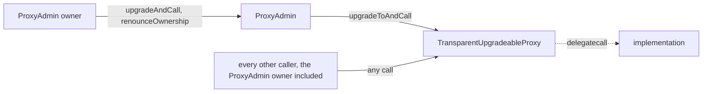

# Upgrade & storage-layout invariants

Each of these contracts is deployed behind its own OpenZeppelin 5.1.0
`TransparentUpgradeableProxy`:

- `ENSRegistry`
- `BaseRegistrarImplementation`
- `SimplexResolver`
- `SubnameRegistrar`
- `SimplexController`
- `SimplexNamePolicy`

Each proxy creates its own `ProxyAdmin` in its constructor; the address of the
`ProxyAdmin` is an immutable of the proxy. The owner of the `ProxyAdmin`
upgrades the proxy with
`ProxyAdmin.upgradeAndCall(proxy, implementation, data)`. An upgrade swaps the
implementation behind a proxy whose storage persists — so the new
implementation **must keep the exact storage layout** of the old one, only
appending. Get this wrong and existing values (prices, the sponsor, …) silently
read from the wrong slots.

Upgradeability is not permanent. A contract is frozen when the owner of its
`ProxyAdmin` calls `renounceOwnership()`: from then on `upgradeAndCall`
reverts, and the proxy's admin, an immutable, cannot be replaced. Each contract
is frozen at a time of its own; everything in this document applies to a
contract until its `ProxyAdmin` is renounced.



## Transparent proxies

- The addresses of the implementation and of the admin are stored at the
  ERC-1967 slots, `keccak256("eip1967.proxy.implementation") - 1` and
  `keccak256("eip1967.proxy.admin") - 1`, outside the sequential layout.
- A call from the `ProxyAdmin` reaches only `upgradeToAndCall`; any other
  function it calls reverts `ProxyDeniedAdminAccess`. A call from any other
  address is delegated to the implementation.
- An implementation must not declare `upgradeTo(address)`,
  `upgradeToAndCall(address,bytes)` or `proxiableUUID()`, so that the
  `ProxyAdmin` stays the only upgrade path.
- An implementation must not write the ERC-1967 slots.
- `test/simplex/__snapshots__/storageLayouts.json` records the storage layout
  of the six implementations, and `test/simplex/TestUpgradeableStack.test.ts`
  compares the compiled layouts with it and checks the six ABIs for the
  selectors above. An upgrade that changes a layout updates the snapshot in the
  same commit (`vitest run -u test/simplex/TestUpgradeableStack.test.ts`). Its
  diff adds lines for new variables after every existing one and, where the
  contract has a `__gap`, moves the `__gap` line by the slots they take and
  shortens it by as many; any other difference breaks the layout.

## Storage model

Slots are laid out base-contracts-first. Where each contract's own variables
start:

| Contract | Slots of the base contracts | First own slot | `__gap` |
|---|---|---|---|
| `ENSRegistry` | 0: `Initializable` | 1 | – |
| `BaseRegistrarImplementation` | 0-9: `ERC721`, `ERC721Enumerable`; 10: `Ownable`, `Initializable` | 11 | – |
| `SimplexResolver` | 0-11: the resolver profiles; 12-13: `PublicResolver` | 14 | – |
| `SubnameRegistrar` | – | 0 | – |
| `SimplexController` | 0-150: `Initializable`, `ContextUpgradeable`, `OwnableUpgradeable`, `Ownable2StepUpgradeable` | 151 | `uint256[43]` |
| `SimplexNamePolicy` | – | 0 | `uint256[42]` |

Each of the six is the most derived contract behind its proxy, so a contract
without `__gap` appends after its last variable.

```
contract SimplexController is
    Initializable, Ownable2StepUpgradeable, IETHRegistrarController, ERC165
```

The OZ upgradeable parents (`Initializable`, `Ownable2Step`) reserve their own
slots and carry their own gaps — leave them alone. They occupy slots 0 to 150,
so this contract's own variables start at slot 151. After them come
`ens`, `base`, `minCommitmentAge`, `maxCommitmentAge`, two reserved slots
(below), `prices`, `tldNode`, `tldSuffix`, `commitments`, `minCharLength`,
`_unusedReservedNames`, `smpxNft` + `nftGateEnabled` + `_unusedPriceOracleFrozen`
(packed), `_reentrancyStatus`, then the names-v2 block:

```solidity
address public beneficiary;
address public sponsor;
address public defaultResolver;                    // packs with `publicSalesOpen`
bool    public publicSalesOpen;
mapping(address => bool) public wasDefaultResolver;
address public namePolicy;

uint256[43] private __gap;   // shrinks as state is added
```

`__gap` was `[50]`; `[49]` when `priceOracleFrozen` landed, `[48]` with
`_reentrancyStatus`, `[44]` with the four names-v2 slots, and `[43]` with
`namePolicy`. It is the budget for future state.

`sponsor` reuses the slot of names-v2's `registrarAllowance`, which no deployed
proxy has held; a mapping's own slot is never written, so it reads as zero under
either type. This is the one sanctioned exception to invariant 2.

**Reserved slots.** Three kinds of placeholder exist, and all are deliberate:

- `_unusedPriceOracleFrozen` — was `priceOracleFrozen`, kept when
  `freezePriceOracle` was removed. Pricing must stay changeable, because the
  Chainlink feed is `immutable` inside the oracle and a retired feed would
  otherwise end registration and renewal forever.
- `_unusedReverseRegistrar`, `_unusedDefaultReverseRegistrar` — were the two
  reverse-registrar references, kept when reverse resolution was removed.
- `_unusedReservedNames` — was `reservedNames`, kept when the reserved-names
  list moved to `SimplexNamePolicy`.

None is written by anything. They exist so removing a feature does not shift
every slot below it, and so the feature can be reintroduced by re-typing the slot
rather than migrating storage. **Removing a variable is not a substitute for
reserving its slot** — see invariant 2.

### `Reason` is storage

`SimplexNamePolicy._names` holds `Reason`, and an enum is stored as its
member's position. Once `.simplex` has reservations, reordering or removing a
member relabels every name reserved under it, with nothing on chain to detect
it. Treat the enum as append-only from then on, and keep `None` at 0 — `delete`
writes zero. The members of `NameEntry` share one slot in declaration order, so
reordering them swaps the two lists; treat the struct as append-only too.

## Invariants (do not break these)

1. **Append only, from the front of `__gap`.** A new state variable is declared
   immediately *before* `__gap`, and `__gap`'s size is decremented by the number
   of 32-byte slots it consumes (one slot for a `mapping`, `address`, `bool`,
   `uintN`, `bytes32`; more for larger structs). Net slot count is unchanged.
   In a contract without `__gap`, it is declared after the last variable. Only
   the most derived contract gains variables: one added to a base contract,
   such as `PublicResolver` or one of its profiles, `ERC721`,
   `ERC721Enumerable` or `Ownable` in a merge from upstream ENS, moves every
   variable declared after it.
2. **Never reorder, remove, retype, or rename-with-different-type** an existing
   state variable. Renaming with the identical type is fine (layout is by
   position+type, not name); changing the type or order corrupts every slot
   after it.
3. **Never reorder the base contracts** in the `is (...)` list, and add no base
   contract with storage — either moves storage.
4. `constant` / `immutable` values are compiled into the implementation, not
   stored in the proxy, so an upgrade replaces them. A new implementation keeps
   the value of each immutable unless changing it is the purpose of the
   upgrade. The immutables of `SimplexResolver` (`ens`; `nameWrapper`, the
   subname registrar; `trustedETHController`, the controller;
   `trustedReverseRegistrar`) and of `SubnameRegistrar` (`ens`,
   `baseRegistrar`, `_deployer`) determine who may write records.
   `scripts/prepare-upgrade.mjs` in brenzi/simplex-namespace-contract compares
   the runtime code of a candidate with its artifact, with the current
   immutables in place.

### Adding a variable — example

```solidity
   mapping(address => bool) public wasDefaultResolver;   // last existing var
+  address public somethingNew;       // new var: takes 1 slot, declared here
-  uint256[44] private __gap;
+  uint256[43] private __gap;         // shrink by 1
```

### Removing a variable — reserve, do not delete

```solidity
-  IReverseRegistrar public reverseRegistrar;
+  address private _unusedReverseRegistrar;   // slot reserved, nothing below moves
```

Same slot count, same slot size. `__gap` is untouched.

## Pre-upgrade checklist

- [ ] **Validate the storage layout against the deployed implementation.**
      `scripts/prepare-upgrade.mjs` in brenzi/simplex-namespace-contract
      compares the layouts, refuses the UUPS selectors, a `fallback` and a
      `receive`, and prints the calldata of `ProxyAdmin.upgradeAndCall`. Update
      `test/simplex/__snapshots__/storageLayouts.json` in the same commit and
      review its diff.
- [ ] **Run the V2 upgrade test** (issue #9): deploy V1 behind a proxy, populate
      state (min char length, NFT gate, oracle, beneficiary, the sponsor,
      the sales switch, the name policy), upgrade to V2 through the
      `ProxyAdmin`, and assert every V1 value survives unchanged and the new
      behaviour works.
- [ ] **Run `test/simplex/TestControllerStorageLayout.test.ts`.** It reads raw
      slots from a deployed proxy and asserts the packing and the reserved slots
      directly.
- [ ] **Review the new code for `delegatecall`.** A `delegatecall` to an address
      other than the contract itself runs that code against the proxy's
      storage, the ERC-1967 slots included.
- [ ] **Review the new code for state written at construction.** A constructor
      or the initializer of a state variable writes the implementation's
      storage, never the proxy's. A new implementation adds no such write;
      state it needs is written by a function passed as the `data` of
      `ProxyAdmin.upgradeAndCall`. The registry's root owner and the
      registrar's `ens`, `baseNode` and owner, written by their constructors,
      reach a proxy only because `initialize` writes them again at deployment.
      `constant` and `immutable` values are exempt (invariant 4). The function
      passed as `data` runs with the `ProxyAdmin` as `msg.sender`: an
      `onlyOwner` function reverts there, a function that records its caller
      records the `ProxyAdmin`, and `SimplexResolver.multicall` reverts
      `ProxyDeniedAdminAccess`, since each of its `delegatecall`s to
      `address(this)` runs the proxy's code with the same `msg.sender`.
- [ ] **Guard the function passed as `data`.** In `ENSRegistry`,
      `BaseRegistrarImplementation` and `SimplexController` it is a
      `reinitializer(n)`. `SimplexNamePolicy`, `SubnameRegistrar` and
      `SimplexResolver` lack `Initializable`, which invariant 3 keeps out:
      there it reverts unless `msg.sender` is the proxy's `ProxyAdmin`. The new
      implementation receives that address, the CREATE address of the proxy at
      nonce 1, as a constructor argument and keeps it in an immutable;
      `scripts/prepare-upgrade.mjs` refuses code that reads the ERC-1967 admin
      slot.
- [ ] Confirm that `owner()` of the proxy's `ProxyAdmin` is the intended admin
      before the upgrade tx. A renounced `ProxyAdmin`, whose owner is `0x0`,
      refuses every upgrade.
- [ ] Bump the `__gap` size in the same commit as any new state variable, so the
      two never drift.

## `SimplexNamePolicy`

The name policy (reserved names, community names, terms links, acceptances) sits
behind its own `TransparentUpgradeableProxy`. Its immutable `controller()` and
`registrar()` bind it to one controller and one registrar;
`scripts/prepare-upgrade.mjs` refuses a candidate whose `controller()` or
`registrar()` differs from the current one. Its own variables are
`_names` (each name's community flag and reservation reason, in one slot),
`communityTermsHash`, `acceptedTerms`, `acceptedClaimTerms`, `nonces`,
`communityTermsLink`, `generalTermsLink`, `generalTermsHash`, then
`uint256[42] __gap`; the invariants above apply to it unchanged.

The policy compiles in the controller's `MIN_REGISTRATION`, `MAX_REGISTRATION` and
`MAX_SPONSORED_REGISTRATION`, and reads the controller's `ens` and `tldNode` once,
in its constructor. A controller upgrade that changed any of them needs a policy
upgrade as well.
