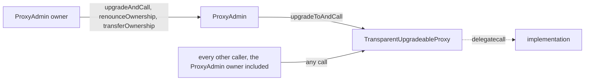

# Upgrade & storage-layout invariants

Each of these contracts is deployed behind its own OpenZeppelin 5.1.0
`TransparentUpgradeableProxy`:

- `ENSRegistry`
- `BaseRegistrarImplementation`
- `SimplexResolver`
- `SubnameRegistrar`
- `SimplexController`
- `SimplexNamePolicy`

The `.testing` controller, a UUPS proxy, is upgraded under `docs/upgrades.md`
at tag `simplex-mainnet-testing-v3`, the source of its fixes.

Each proxy creates its own `ProxyAdmin` in its constructor; the address of the
`ProxyAdmin` is an immutable of the proxy. The owner of the `ProxyAdmin`
upgrades the proxy with
`ProxyAdmin.upgradeAndCall(proxy, implementation, data)`. An upgrade swaps the
implementation behind a proxy whose storage persists — so the new
implementation **must keep the exact storage layout** of the old one, only
appending. Get this wrong and existing values (prices, the sponsor, …) silently
read from the wrong slots.

Upgradeability is not permanent. A contract is frozen when the owner of its
`ProxyAdmin` calls `renounceOwnership()`: from then on `upgradeAndCall`
reverts, and the proxy's admin, an immutable, cannot be replaced. Each contract
is frozen at a time of its own; everything in this document applies to a
contract until its `ProxyAdmin` is renounced. `renounceOwnership()` and
`transferOwnership` are sent to the `ProxyAdmin`, the CREATE address of the
proxy at nonce 1 that `scripts/prepare-upgrade.mjs` prints, never to the proxy:
the same selectors are declared by `BaseRegistrarImplementation` and
`SimplexController`, and a call of the `ProxyAdmin` owner to the proxy is
delegated to them and applied to the contract's own ownership.



## Transparent proxies

- The addresses of the implementation and of the admin are stored at the
  ERC-1967 slots, `keccak256("eip1967.proxy.implementation") - 1` and
  `keccak256("eip1967.proxy.admin") - 1`, outside the sequential layout.
- For a call from the `ProxyAdmin`, only `upgradeToAndCall` is executed; any
  other call from it is reverted with `ProxyDeniedAdminAccess`. A call from any
  other address is delegated to the implementation.
- An implementation must not declare `upgradeTo(address)`,
  `upgradeToAndCall(address,bytes)` or `proxiableUUID()`, so that the
  `ProxyAdmin` stays the only upgrade path.
- An implementation must not write the ERC-1967 slots.
- `test/simplex/__snapshots__/storageLayouts.json` records the storage layout
  of the six implementations, and `test/simplex/TestUpgradeableStack.test.ts`
  compares the compiled layouts with it and checks the six ABIs for the
  selectors above. An upgrade that changes a layout updates the snapshot in the
  same commit (`vitest run -u test/simplex/TestUpgradeableStack.test.ts`), and
  its diff follows invariants 1 and 2: the lines of new variables are inserted
  before the trailing `__gap`, or appended in a contract without one; values
  are appended to the list of an enum; the start slot of the `__gap` line is
  raised, and its length reduced, by the whole slots occupied by the new
  variables; every other line is unchanged.

## Storage model

Slots are laid out base-contracts-first. Where each contract's own variables
start:

| Contract | Slots of the base contracts | First own slot | `__gap` |
|---|---|---|---|
| `ENSRegistry` | 0: `Initializable` | 1 | – |
| `BaseRegistrarImplementation` | 0-9: `ERC721`, `ERC721Enumerable`; 10: `Ownable`, `Initializable` | 11 | – |
| `SimplexResolver` | 0-11: the resolver profiles; 12-13: `PublicResolver` | 14 | – |
| `SubnameRegistrar` | – | 0 | – |
| `SimplexController` | 0-150: `Initializable`, `ContextUpgradeable`, `OwnableUpgradeable`, `Ownable2StepUpgradeable` | 151 | `uint256[43]` |
| `SimplexNamePolicy` | – | 0 | `uint256[42]` |

Each of the six is the most derived contract behind its proxy, so a contract
without `__gap` appends after its last variable.

```
contract SimplexController is
    Initializable, Ownable2StepUpgradeable, IETHRegistrarController, ERC165
```

Slots 0 to 150 are taken by the OZ upgradeable parents and are left alone: slot
0 by `Initializable`, which has no `__gap`, and slots 1 to 150 by
`ContextUpgradeable`, `OwnableUpgradeable` and `Ownable2StepUpgradeable`, each
with its own `__gap`. This contract's own variables start at slot 151. After
them come
`ens`, `base`, `minCommitmentAge`, `maxCommitmentAge`, two reserved slots
(below), `prices`, `tldNode`, `tldSuffix`, `commitments`, `minCharLength`,
`_unusedReservedNames`, `smpxNft` + `nftGateEnabled` + `_unusedPriceOracleFrozen`
(packed), `_reentrancyStatus`, then the names-v2 block:

```solidity
address public beneficiary;
address public sponsor;
address public defaultResolver;                    // packs with `publicSalesOpen`
bool    public publicSalesOpen;
mapping(address => bool) public wasDefaultResolver;
address public namePolicy;

uint256[43] private __gap;   // shrinks as state is added
```

`__gap` was `[50]`; `[49]` when `priceOracleFrozen` landed, `[48]` with
`_reentrancyStatus`, `[44]` with the four names-v2 slots, and `[43]` with
`namePolicy`. It is the budget for future state.

**Reserved slots.** Three kinds of placeholder exist, and all are deliberate:

- `_unusedPriceOracleFrozen` — was `priceOracleFrozen`, kept when
  `freezePriceOracle` was removed. Pricing must stay changeable, because the
  Chainlink feed is `immutable` inside the oracle and a retired feed would
  otherwise end registration and renewal forever.
- `_unusedReverseRegistrar`, `_unusedDefaultReverseRegistrar` — were the two
  reverse-registrar references, kept when reverse resolution was removed.
- `_unusedReservedNames` — was `reservedNames`, kept when the reserved-names
  list moved to `SimplexNamePolicy`.

None is written by anything. They exist so removing a feature does not shift
every slot below it, and their declarations are kept (invariant 2).

### `Reason` is storage

`SimplexNamePolicy._names` holds `Reason`, and an enum is stored as its
member's position. Once `.simplex` has reservations, reordering or removing a
member relabels every name reserved under it, with nothing on chain to detect
it. Values are only appended to the enum (invariant 2), and `None` is kept at
0 — `delete` writes zero. The members of `NameEntry` share one slot in
declaration order, so reordering them swaps the two lists; keep them unchanged
(invariant 2).

## Invariants (do not break these)

1. **Append only, from the front of `__gap`.** A new state variable is declared
   immediately *before* `__gap`. The end slot of the trailing `__gap` is
   unchanged, and `__gap` is shortened by the whole slots occupied by the new
   variables; none is occupied by a variable packed into the unused bytes of
   the preceding slot, so `__gap` is unchanged by a `bool` after
   `SimplexController.namePolicy` (slot 169, offset 20). In a contract without
   `__gap`, a new variable is declared after the last one. Only the most
   derived contract gains variables: one added to a base contract, such as
   `PublicResolver` or one of its profiles, `ERC721`, `ERC721Enumerable` or
   `Ownable` in a merge from upstream ENS, moves every variable declared after
   it.
2. **The label, slot, offset and type of an existing variable are unchanged.**
   Never reorder, remove, rename or retype one. The members of a stored struct
   are unchanged, and values are only appended to an enum.
3. **Never reorder the base contracts** in the `is (...)` list, and add no base
   contract with storage — either moves storage. `Initializable` is kept at
   `@openzeppelin/contracts-upgradeable` 4.9.3 in `ENSRegistry`,
   `BaseRegistrarImplementation` and `SimplexController`: its `_initialized`
   (in the registrar, slot 10, offset 20) is the only barrier against a second
   `initialize`, and the state of the 5.x `Initializable` is read from an
   ERC-7201 slot, zero in an existing proxy, so anyone could then call, for
   example, `initialize(ens, baseNode, attacker)` on the registrar.
4. `constant` / `immutable` values are compiled into the implementation, not
   stored in the proxy, so an upgrade replaces them. A new implementation keeps
   the value of each immutable unless changing it is the purpose of the
   upgrade. The immutables of `SimplexResolver` (`ens`; `nameWrapper`, the
   subname registrar; `trustedETHController`, the controller;
   `trustedReverseRegistrar`) and of `SubnameRegistrar` (`ens`,
   `baseRegistrar`) determine who may write records; `SubnameRegistrar`'s
   `_deployer` is the only caller of its one-time `setResolver`.
   `scripts/prepare-upgrade.mjs` in brenzi/simplex-namespace-contract compares
   the runtime code of a candidate with its artifact, with the current
   immutables in place.

### Adding a variable — example

```solidity
   address public namePolicy;          // last existing variable, slot 169
+  address public somethingNew;        // slot 170, one whole slot
-  uint256[43] private __gap;
+  uint256[42] private __gap;          // slots 171-212, ends where it did
```

### Retiring a variable — keep its declaration

A variable out of use is kept with its label, type and place, so no slot below
it is moved and `__gap` is untouched.

## Pre-upgrade checklist

- [ ] **Validate the storage layout against the deployed implementation.**
      `scripts/prepare-upgrade.mjs` in brenzi/simplex-namespace-contract
      compares the layouts, refuses the UUPS selectors, a `fallback` and a
      `receive`, and prints the calldata of `ProxyAdmin.upgradeAndCall`. Update
      `test/simplex/__snapshots__/storageLayouts.json` in the same commit and
      review its diff.
- [ ] **Run an upgrade test of the contract being upgraded.** Copy the source
      of its deployed version, from the tag of that deployment, to
      `contracts/test/upgrades/` under another contract name; deploy the copy
      behind a `TransparentUpgradeableProxy`, write every stored variable,
      upgrade through the `ProxyAdmin` with the intended `data`, and assert
      every value and the guard of the `data` function.
- [ ] **Run `test/simplex/TestControllerStorageLayout.test.ts`.** It reads raw
      slots from a deployed proxy and asserts the packing and the reserved slots
      directly.
- [ ] **Review the new code for `delegatecall`.** A `delegatecall` to an address
      other than the contract itself runs that code against the proxy's
      storage, the ERC-1967 slots included.
- [ ] **Review the new code for state written at construction.** A constructor
      or the initializer of a state variable writes the implementation's
      storage, never the proxy's. A new implementation adds no such write;
      state it needs is written by a function passed as the `data` of
      `ProxyAdmin.upgradeAndCall`. The registry's root owner and the
      registrar's `ens`, `baseNode` and owner, written by their constructors,
      reach a proxy only because `initialize` writes them again at deployment.
      `constant` and `immutable` values are exempt (invariant 4). The function
      passed as `data` runs with the `ProxyAdmin` as `msg.sender`: an
      `onlyOwner` function reverts there, a function that records its caller
      records the `ProxyAdmin`, and with `SimplexResolver.multicall` as `data`,
      `upgradeAndCall` reverts `FailedCall()`: each `delegatecall` of
      `multicall` to `address(this)` is executed by the proxy's code with the
      same `msg.sender` and reverts `ProxyDeniedAdminAccess`, an error discarded
      by `require(success)`.
- [ ] **Review the new immutables.** A new immutable is assigned from
      constructor arguments only: at construction, `address(this)` is the
      implementation and `msg.sender` its deployer, so a domain separator or an
      owner derived from either is wrong under the proxy.
      `SimplexNamePolicy._self` and `SubnameRegistrar._deployer` hold the
      implementation and its deployer by design.
- [ ] **Guard the function passed as `data`.** In each of the six contracts it
      reverts unless `msg.sender` equals the immutable `_proxyAdmin`, the
      proxy's `ProxyAdmin` (its CREATE address at nonce 1), passed to the new
      implementation as a constructor argument. In `ENSRegistry`,
      `BaseRegistrarImplementation` and `SimplexController` it is also a
      `reinitializer(n)`. `scripts/prepare-upgrade.mjs` passes the proxy's
      `ProxyAdmin` automatically to a constructor input named `_proxyAdmin`,
      checks the immutable `_proxyAdmin` against that `ProxyAdmin`, refuses a
      non-empty `data` for a candidate without a `_proxyAdmin` immutable,
      refuses code that contains an ERC-1967 slot, encodes the `data`, and
      simulates the upgrade.
- [ ] Confirm that `owner()` of the proxy's `ProxyAdmin` is the intended admin
      before the upgrade tx. A renounced `ProxyAdmin`, whose owner is `0x0`,
      refuses every upgrade.
- [ ] Bump the `__gap` size in the same commit as any new state variable, so the
      two never drift.

## `SimplexNamePolicy`

The name policy (reserved names, community names, terms links, acceptances) sits
behind its own `TransparentUpgradeableProxy`. Its immutable `controller()` and
`registrar()` bind it to one controller and one registrar;
`scripts/prepare-upgrade.mjs` refuses a candidate whose `controller()` or
`registrar()` differs from the current one, unless its `INTENDED` input names
that immutable for an intended change. Its own variables are
`_names` (each name's community flag and reservation reason, in one slot),
`communityTermsHash`, `acceptedTerms`, `acceptedClaimTerms`, `nonces`,
`communityTermsLink`, `generalTermsLink`, `generalTermsHash`, then
`uint256[42] __gap`; the invariants above apply to it unchanged.

The policy compiles in the controller's `MIN_REGISTRATION`, `MAX_REGISTRATION` and
`MAX_SPONSORED_REGISTRATION`, and reads the controller's `ens` and `tldNode` once,
in its constructor. A controller upgrade that changed any of them needs a policy
upgrade as well.
